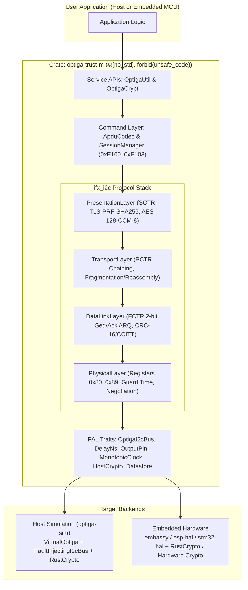

# 00 — Master Architecture, Core Traits & Error Hierarchy

## 1. Architectural Vision

The C reference implementation ([`optiga-trust-m`](file:///Users/chris/Development/optiga/optiga-trust-m)) implements the Infineon I2C Protocol v2.03 and OPTIGA Trust M command set using a 5-layer callback chain operating on a global mutable singleton (`ifx_i2c_context_0`, `g_optiga`).

Our Rust implementation replaces this with **composable, owned, `#![no_std]` state machines** generic over hardware traits (`embedded-hal` / `embedded-hal-async`), providing compile-time safety, zero heap allocation, and deterministic host-based testability.



---

## 2. Cargo Workspace & Module Layout

```text
/Users/chris/Development/optiga/
├── Cargo.toml                        # Workspace root
├── docs/
│   └── architecture/                 # This specification suite
├── crates/
│   ├── optiga-trust-m/               # Core #![no_std] library
│   │   ├── Cargo.toml
│   │   └── src/
│   │       ├── lib.rs
│   │       ├── config.rs             # Protocol constants & timing defaults
│   │       ├── error.rs              # Hierarchical Error enums
│   │       ├── endian.rs             # Big-endian u16/u24/u32 slice readers/writers
│   │       ├── pal/
│   │       │   ├── mod.rs            # OptigaI2cBus, MonotonicClock, Datastore, HostCrypto traits
│   │       │   └── rust_crypto.rs    # Pure-Rust #![no_std] AES-128-CCM-8 & TLS-1.2-PRF-SHA256
│   │       ├── ifx_i2c/
│   │       │   ├── mod.rs            # IfxI2cStack coordinator & ResetType / ProtectionLevel
│   │       │   ├── physical.rs       # Layer 1: Register I/O, negotiation, reset, polling
│   │       │   ├── datalink.rs       # Layer 2: Fctr, Crc16Ccitt, modulo-4 ARQ state machine
│   │       │   ├── transport.rs      # Layer 3: Pctr, chaining state table, fragmentation
│   │       │   └── presentation.rs   # Layer 4: Sctr, handshake, record exchange, manage context
│   │       ├── cmd/
│   │       │   ├── mod.rs            # Layer 5: APDU framing, auto-0xF1C2 error fetch, SessionGuard
│   │       │   ├── tlv.rs            # Zero-copy TLV builder & parser
│   │       │   └── types.rs          # OIDs, KeyIds, CurveIds, AlgorithmIds
│   │       ├── util.rs               # High-level Data/Metadata/Counter/ProtectedUpdate API
│   │       └── crypt.rs              # High-level RNG/Hash/ECC/RSA/ECDH/KDF/Symmetric API
│   └── optiga-sim/                   # Host-side Virtual OPTIGA Chip & Fault Injection Harness
│       ├── Cargo.toml
│       └── src/
│           ├── lib.rs
│           ├── clock.rs              # Deterministic simulated clock & DelayNs tracker
│           ├── datastore.rs          # In-memory Datastore with default platform binding secret
│           ├── virtual_chip/         # Full slave state machine (registers, DL, TL, PRL, APDU)
│           └── fault_bus.rs          # Programmable MITM fault injector (NACKs, bitflips, drops)
└── optiga-trust-m/                   # Original Infineon C reference codebase (read-only reference)
```

---

## 3. Eliminating C Anti-Patterns

| C Implementation Pattern | Location in C | Rust Replacement Pattern |
| :--- | :--- | :--- |
| **5-level `void*` Callback Chain** | `ifx_i2c_event_handler_t` across `pl`, `dl`, `tl`, `prl`, `comms` | Direct synchronous (`embedded-hal`) or `async` (`embedded-hal-async` / `maybe-async`) methods returning `Result<usize, Error>`. State persists in owned struct fields (`pl: PhysicalLayer`, `dl: DataLinkLayer`, etc.). |
| **Caller Buffer In-Place Mutation & 5-Byte Offset Hack** | `IFX_I2C_PRL_OVERHEAD_SIZE` (13B) and `IFX_I2C_DATA_OFFSET` (5B) in [`ifx_i2c_config.h`](file:///Users/chris/Development/optiga/optiga-trust-m/include/ifx_i2c/ifx_i2c_config.h#L118-L135) | Callers pass clean `tx: &[u8]` and `rx: &mut [u8]`. The Presentation/Transport layer manages its own internal `apdu_scratch: [u8; MAX_APDU_LEN + PRL_OVERHEAD]` buffer. |
| **Global Mutable Singleton** | `ifx_i2c_context_0` in [`ifx_i2c_config.c`](file:///Users/chris/Development/optiga/optiga-trust-m/src/comms/ifx_i2c/ifx_i2c_config.c#L70) and `g_optiga` in [`optiga_cmd.c`](file:///Users/chris/Development/optiga/optiga-trust-m/src/cmd/optiga_cmd.c#L437) | Owned `OptigaTrustM<I2C, D, VDD, RST, CLK, CRYPTO, DS>` instance struct; supports multiple independent OPTIGA chips on different I2C buses or addresses without global state. |
| **Busy-Wait Spin Loop on Global `volatile` in `write_slave_address`** | `g_pal_event_status` spin-loop in [`ifx_i2c_physical_layer.c:227`](file:///Users/chris/Development/optiga/optiga-trust-m/src/comms/ifx_i2c/ifx_i2c_physical_layer.c#L222-L234) | Standard retry loop using `OptigaI2cBus::write` and `DelayNs::delay_ms(1)`. |
| **Manual `uint32_t` Timestamp Wraparound Math** | `(0xFFFFFFFF + (current_time - start_time)) + 0x01` in [`ifx_i2c_physical_layer.c:518`](file:///Users/chris/Development/optiga/optiga-trust-m/src/comms/ifx_i2c/ifx_i2c_physical_layer.c#L514-L520) | `current_time.wrapping_sub(start_time) < timeout_ms` in Rust! |
| **Heavy C Mbed TLS 4.x Dependency for 2 Primitives** | [`pal_crypt_psa.c`](file:///Users/chris/Development/optiga/optiga-trust-m/extras/pal/pal_crypt_psa.c) | Pure-Rust `#![no_std]` implementation of `HostCrypto` using `aes`, `ccm`, `hmac`, and `sha2` crates. |

---

## 4. Platform Abstraction Layer (`pal`) Traits

All hardware and OS dependencies in [`include/pal/`](file:///Users/chris/Development/optiga/optiga-trust-m/include/pal) are modeled as clean Rust traits in `src/pal/mod.rs`:

```rust
use embedded_hal::delay::DelayNs;
use embedded_hal::digital::OutputPin;
use embedded_hal::i2c::I2c;

/// Extension of `embedded_hal::i2c::I2c` supporting dynamic bus speed negotiation.
/// Maps to `pal_i2c_write`, `pal_i2c_read`, and `pal_i2c_set_bitrate`.
pub trait OptigaI2cBus: I2c {
    /// Sets the I2C master clock frequency in kHz (e.g., 100 for standard negotiation, up to 1000 for FM+).
    /// Must return `Err` if the bus is busy or the hardware cannot support any valid rate.
    /// Note: Per C PAL spec, if `bitrate_khz` exceeds the master hardware's max supported bitrate,
    /// the implementation may clamp to its max supported bitrate or return an error if negotiation requires exact check.
    fn set_bitrate_khz(&mut self, bitrate_khz: u16) -> Result<(), Self::Error>;
}

/// Monotonic millisecond clock used for Data Link and Transport layer timeout bounds.
/// Maps to `pal_os_timer_get_time_in_milliseconds()`.
pub trait MonotonicClock {
    /// Returns current monotonic tick count in milliseconds (wrapping at `u32::MAX` is handled via `wrapping_sub`).
    fn now_ms(&self) -> u32;
}

/// Well-known datastore slots from `pal_os_datastore.h`.
#[derive(Debug, Clone, Copy, PartialEq, Eq)]
#[repr(u16)]
pub enum DatastoreId {
    /// `OPTIGA_PLATFORM_BINDING_SHARED_SECRET_ID` (`0x11`), max length 64 bytes (`0x40`).
    PlatformBindingSharedSecret = 0x0011,
    /// `OPTIGA_COMMS_MANAGE_CONTEXT_ID` (`0x22`), stores serialized `SavedSecContext`.
    ManageContext = 0x0022,
    /// `OPTIGA_HIBERNATE_CONTEXT_ID` (`0x33`), stores 8-byte application context handle.
    HibernateContext = 0x0033,
}

/// Persistent or RAM-backed key/context storage.
/// Maps to `pal_os_datastore_read` and `pal_os_datastore_write`.
pub trait Datastore {
    type Error: core::fmt::Debug;

    /// Reads the entry for `id` into `buf`, returning the number of bytes read.
    fn read(&self, id: DatastoreId, buf: &mut [u8]) -> Result<usize, Self::Error>;

    /// Writes `data` to the slot identified by `id`.
    fn write(&mut self, id: DatastoreId, data: &[u8]) -> Result<(), Self::Error>;
}

/// Host-side cryptographic primitives required by the Presentation Layer (Shielded Connection).
/// Maps to `pal_crypt.h`.
pub trait HostCrypto {
    type Error: core::fmt::Debug;

    /// Derives `out.len()` bytes (typically 40 bytes) using TLS 1.2 PRF with HMAC-SHA256 (RFC 5246 Section 5).
    fn tls_prf_sha256(
        &mut self,
        secret: &[u8],
        label: &[u8],
        seed: &[u8],
        out: &mut [u8],
    ) -> Result<(), Self::Error>;

    /// Encrypts `buf` in-place using AES-128-CCM with an 8-byte MAC tag (`AES-128-CCM-8`) and 8-byte nonce.
    /// Returns the 8-byte authentication tag.
    fn aes128_ccm_8_encrypt(
        &mut self,
        key: &[u8; 16],
        nonce: &[u8; 8],
        associated_data: &[u8],
        buf: &mut [u8],
    ) -> Result<[u8; 8], Self::Error>;

    /// Decrypts `buf` in-place and verifies the 8-byte `tag` using AES-128-CCM-8.
    /// Must zeroize `buf` and return `Err` if tag verification fails!
    fn aes128_ccm_8_decrypt(
        &mut self,
        key: &[u8; 16],
        nonce: &[u8; 8],
        associated_data: &[u8],
        buf: &mut [u8],
        tag: &[u8; 8],
    ) -> Result<(), Self::Error>;
}
```

### Optional GPIO Pins
In hardware setups where `VDD` and/or `RESET` pins are hardwired rather than controlled by MCU GPIOs, users can pass a no-op pin implementation `NoPin` (which implements `embedded_hal::digital::OutputPin` as a no-op) or `Option<P>`, matching the C behavior where `NULL` pin pointers skip toggling without failing ([`ifx_i2c.h:105`](file:///Users/chris/Development/optiga/optiga-trust-m/include/ifx_i2c/ifx_i2c.h#L105-L106)).

---

## 5. Comprehensive Error Hierarchy (`src/error.rs`)

All C status codes in [`ifx_i2c_config.h`](file:///Users/chris/Development/optiga/optiga-trust-m/include/ifx_i2c/ifx_i2c_config.h#L75-L89) and [`optiga_lib_return_codes.h`](file:///Users/chris/Development/optiga/optiga-trust-m/include/common/optiga_lib_return_codes.h) map cleanly to strongly-typed Rust enums:

```rust
/// Errors originating from the IFX I2C Protocol Stack (`ifx_i2c`).
#[derive(Debug, Clone, Copy, PartialEq, Eq)]
pub enum IfxI2cError {
    /// `IFX_I2C_STACK_BUSY` (`0x0001`): Stack or bus is currently busy.
    Busy,
    /// `IFX_I2C_STACK_ERROR` (`0x0102`): General protocol error (invalid state, NACK limit, bad negotiation).
    ProtocolError,
    /// `IFX_I2C_STACK_MEM_ERROR` (`0x0104`): Receive buffer capacity insufficient for incoming packet.
    MemoryInsufficient,
    /// `IFX_I2C_FATAL_ERROR` (`0x0106`): Physical layer polling limit (`PL_POLLING_MAX_CNT = 200`) exhausted.
    FatalError,
    /// `IFX_I2C_HANDSHAKE_ERROR` (`0x0107`): Presentation layer handshake failed (PRF, Finished verify, or Alert).
    HandshakeError,
    /// `IFX_I2C_SESSION_ERROR` (`0x0108`): Established secure session was closed or desynchronized.
    SessionError,
}

/// Device-level error codes read from OID `0xF1C2` when APDU `Sta == 0xFF` (`OPTIGA_DEVICE_ERROR = 0x8000 | code`).
/// Reference: OPTIGA Trust M Solution Reference Manual v3.60.
#[derive(Debug, Clone, Copy, PartialEq, Eq)]
#[repr(u8)]
pub enum DeviceError {
    InvalidOid = 0x01,
    InvalidPassword = 0x02,
    InvalidParamField = 0x03,
    InvalidLengthField = 0x04,
    InvalidParameterInDataField = 0x05,
    InternalProcessError = 0x06,
    AccessConditionNotSatisfied = 0x07,
    DataObjectBoundaryExceeded = 0x08,
    MetadataTruncationError = 0x09,
    InvalidCommandField = 0x0A,
    CommandOutOfSequence = 0x0B,
    CommandNotAvailable = 0x0C,
    InsufficientMemory = 0x0D,
    CounterThresholdLimitExceeded = 0x0E,
    InvalidManifest = 0x0F,
    InvalidPayloadVersion = 0x10,
    InvalidHandShakeMessage = 0x21,
    VersionMismatch = 0x22,
    InsufficientCipherSuite = 0x23,
    UnsupportedExtensionIdentifier = 0x24,
    InvalidTrustAnchor = 0x26,
    TrustAnchorExpired = 0x27,
    UnsupportedTrustAnchor = 0x28,
    InvalidCertificateFormat = 0x29,
    UnsupportedCertificateAlgorithm = 0x2A,
    CerificateExpired = 0x2B,
    SignatureVerificationFailure = 0x2C,
    IntegrityValidationFailure = 0x2D,
    DecryptionFailure = 0x2E,
    GeneralError = 0xFF,
    Unknown(u8),
}

/// Top-level error returned by `OptigaCmd`, `OptigaUtil`, and `OptigaCrypt`.
#[derive(Debug, Clone, Copy, PartialEq, Eq)]
pub enum OptigaError {
    /// Lower-level IFX I2C communication stack error.
    Comms(IfxI2cError),
    /// Invalid arguments passed to API (`OPTIGA_CMD_ERROR_INVALID_INPUT` / `0x0203`).
    InvalidInput,
    /// Buffer too small for APDU or response (`OPTIGA_CMD_ERROR_MEMORY_INSUFFICIENT` / `0x0204`).
    MemoryInsufficient,
    /// Instance or session is already in use (`0x0305` / `0x0405`).
    InstanceInUse,
    /// Command execution error inside the state machine (`0x0202`).
    CommandError,
    /// Security chip returned APDU `Sta == 0xFF` and error code from `0xF1C2` (`0x80XX`).
    Device(DeviceError),
    /// Error reading/writing host Datastore.
    DatastoreError,
}
```

---

## 6. Protocol Configuration Constants (`src/config.rs`)

All magic constants from [`ifx_i2c_config.h`](file:///Users/chris/Development/optiga/optiga-trust-m/include/ifx_i2c/ifx_i2c_config.h) and [`optiga_lib_config_m_v3.h`](file:///Users/chris/Development/optiga/optiga-trust-m/include/optiga_lib_config_m_v3.h) must be defined as typed constants in `src/config.rs`:

```rust
/// Default 7-bit I2C slave address of OPTIGA Trust M (`IFX_I2C_BASE_ADDR`).
pub const IFX_I2C_BASE_ADDR: u8 = 0x30;

/// Maximum supported Data Link Layer frame size in OPTIGA (`IFX_I2C_FRAME_SIZE`).
pub const MAX_FRAME_SIZE: usize = 277;
/// Minimum supported Data Link Layer frame size (`16`).
pub const MIN_FRAME_SIZE: usize = 16;

/// Physical Layer polling interval when slave NACKs or is busy (`PL_POLLING_INVERVAL_US = 1000 µs`).
pub const PL_POLLING_INTERVAL_US: u32 = 1_000;
/// Maximum Physical Layer NACK/busy polling attempts (`PL_POLLING_MAX_CNT = 200`).
pub const PL_POLLING_MAX_CNT: u16 = 200;
/// Physical Layer `I2C_STATE` (`0x82`) response polling interval (`PL_DATA_POLLING_INVERVAL_US = 5000 µs`).
pub const PL_DATA_POLLING_INTERVAL_US: u32 = 5_000;
/// Mandatory Physical Layer guard time after every I2C read/write (`PL_GUARD_TIME_INTERVAL_US = 50 µs`).
pub const PL_GUARD_TIME_INTERVAL_US: u32 = 50;
/// Default initial negotiation I2C frequency in kHz (`PL_DEFAULT_FREQUENCY = 100 kHz`).
pub const PL_DEFAULT_FREQUENCY_KHZ: u16 = 100;
/// Threshold between SM/FM (`<= 400 kHz`) and FM+ (`> 400 kHz`) (`PL_SM_FM_MAX_FREQUENCY = 400 kHz`).
pub const PL_SM_FM_MAX_FREQUENCY_KHZ: u16 = 400;

/// GPIO Reset low hold time in milliseconds (`RESET_LOW_TIME_MSEC = 2000` in C config, Note: C passes this to `oneshot(..., time_us)` which is actually 2000 µs = 2 ms!).
/// See Section 2.3 of `01_PHYSICAL_LAYER_PL.md` for details on the C unit quirk.
pub const RESET_LOW_TIME_US: u32 = 2_000;
/// Startup delay after reset release or soft reset (`STARTUP_TIME_MSEC = 12000` passed as µs = 12 ms).
pub const STARTUP_TIME_US: u32 = 12_000;

/// Data Link Layer header + CRC overhead (`DL_HEADER_SIZE = 5` bytes: 1B FCTR + 2B LEN + 2B CRC).
pub const DL_HEADER_SIZE: usize = 5;
/// Data Link Layer max retransmission count before RESYNC (`DL_TRANS_REPEAT = 3`).
pub const DL_TRANS_REPEAT: u8 = 3;
/// Data Link Layer poll timeout when waiting for immediate ACK after TX (`PL_TRANS_TIMEOUT_MS = 10 ms`).
pub const PL_TRANS_TIMEOUT_MS: u32 = 10;

/// Transport Layer header size (`TL_HEADER_SIZE = 1` byte: PCTR).
pub const TL_HEADER_SIZE: usize = 1;
/// Transport Layer maximum exit timeout in milliseconds (`TL_MAX_EXIT_TIMEOUT = 180 s = 180_000 ms`).
pub const TL_MAX_EXIT_TIMEOUT_MS: u32 = 180_000;

/// Presentation Layer header size for protected records (`IFX_I2C_PRL_HEADER_SIZE = 5`: 1B SCTR + 4B SeqNr).
pub const PRL_HEADER_SIZE: usize = 5;
/// Presentation Layer AES-CCM MAC size (`IFX_I2C_PRL_MAC_SIZE = 8`).
pub const PRL_MAC_SIZE: usize = 8;
/// Total Presentation Layer overhead (`PRL_OVERHEAD_SIZE = 13` bytes).
pub const PRL_OVERHEAD_SIZE: usize = PRL_HEADER_SIZE + PRL_MAC_SIZE;

/// Maximum APDU communication buffer size (`OPTIGA_MAX_COMMS_BUFFER_SIZE = 0x615 = 1557` bytes).
pub const OPTIGA_MAX_COMMS_BUFFER_SIZE: usize = 1557;
```
