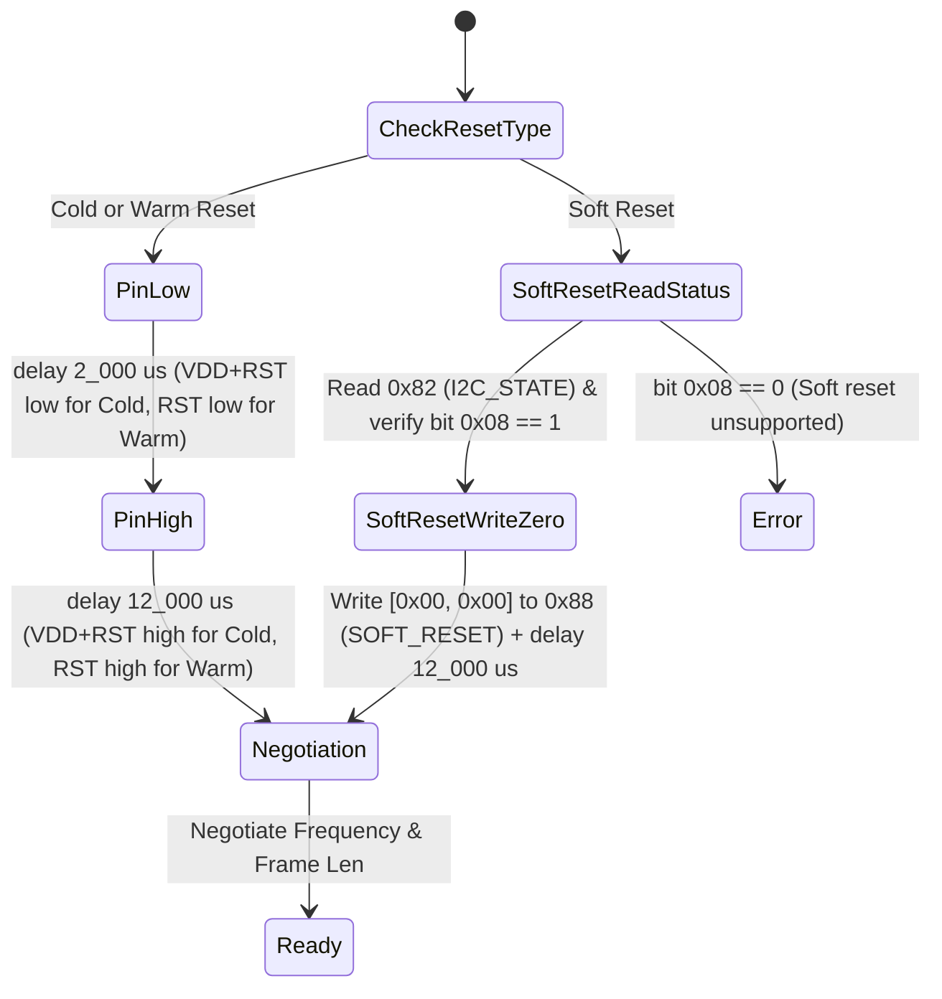

# 01 — Physical Layer (`ifx_i2c::physical`) Specification

**Primary C References:**
- [`optiga-trust-m/src/comms/ifx_i2c/ifx_i2c_physical_layer.c`](file:///Users/chris/Development/optiga/optiga-trust-m/src/comms/ifx_i2c/ifx_i2c_physical_layer.c)
- [`optiga-trust-m/include/ifx_i2c/ifx_i2c_physical_layer.h`](file:///Users/chris/Development/optiga/optiga-trust-m/include/ifx_i2c/ifx_i2c_physical_layer.h)
- [`optiga-trust-m/src/comms/ifx_i2c/ifx_i2c.c`](file:///Users/chris/Development/optiga/optiga-trust-m/src/comms/ifx_i2c/ifx_i2c.c)

---

## 1. Overview & Responsibilities

The Physical Layer (`PhysicalLayer`) is the lowest layer of the `ifx_i2c` stack. It abstracts raw I2C master transactions and GPIO reset pins into a **frame-oriented register interface** communicating with the OPTIGA slave device (default 7-bit address `0x30`).

Its core responsibilities are:
1. **Register-level I2C Read/Write** with mandatory **$50\ \mu\text{s}$ guard time** (`PL_GUARD_TIME_INTERVAL_US`) and **NACK/Busy wakeup retry polling** (`PL_POLLING_MAX_CNT = 200` attempts at `1000 µs` intervals).
2. **Device Reset Sequencing**: Cold Reset (toggling `VDD` + `RST` pins), Warm Reset (toggling `RST` pin), and Soft Reset (writing `0x0000` to register `0x88`).
3. **Bus Speed & Frame Size Negotiation**: Negotiating `I2C_MODE` (`0x89`), `MAX_SCL_FREQU` (`0x84`), and `DATA_REG_LEN` (`0x81`) upon initialization/reset.
4. **Frame Transmission & Reception**: Writing frames to `DATA` (`0x80`) and polling `I2C_STATE` (`0x82`) every `5000 µs` until a response frame is ready to be read from `DATA` (`0x80`).
5. **Dynamic Slave Address Configuration**: Writing volatile or persistent 7-bit slave addresses to `BASE_ADDR` (`0x83`).

---

## 2. Virtual Register File Specification

All I2C communications with the OPTIGA slave address a 1-byte register ID:

```rust
#[derive(Debug, Clone, Copy, PartialEq, Eq)]
#[repr(u8)]
pub enum PlRegister {
    /// `PL_REG_DATA` (`0x80`): Variable length (1..=`frame_size` bytes). Read/Write data frames.
    Data = 0x80,
    /// `PL_REG_DATA_REG_LEN` (`0x81`): 2 bytes (u16 BE). Max frame length (`16..=277`). Read/Write.
    DataRegLen = 0x81,
    /// `PL_REG_I2C_STATE` (`0x82`): 4 bytes. Slave status & available response length. Read-only.
    I2cState = 0x82,
    /// `PL_REG_BASE_ADDR` (`0x83`): 2 bytes (`[mode, addr & 0x7F]`). Slave I2C address. Write-only.
    BaseAddr = 0x83,
    /// `PL_REG_MAX_SCL_FREQU` (`0x84`): 4 bytes (bytes 2..=3 = max kHz BE). Read-only.
    MaxSclFrequ = 0x84,
    /// `PL_REG_SOFT_RESET` (`0x88`): 2 bytes (`[0x00, 0x00]`). Triggers soft reset. Write-only.
    SoftReset = 0x88,
    /// `PL_REG_I2C_MODE` (`0x89`): 2 bytes (`[0x80, mode]`). SM/FM (`0x03`) or FM+ (`0x04`). Write-only.
    I2cMode = 0x89,
}
```

### 2.1 `I2C_STATE` (`0x82`) 4-Byte Register Layout
When reading 4 bytes from `PlRegister::I2cState` (`0x82`):
- **`byte[0]` (Status Flags)**:
  - Bit 7 (`0x80`): `BUSY` — Slave is currently busy processing a command (note: C implementation ignores the busy flag when reading if `RESPONSE_READY` is set; see [`ifx_i2c_physical_layer.c:506`](file:///Users/chris/Development/optiga/optiga-trust-m/src/comms/ifx_i2c/ifx_i2c_physical_layer.c#L506-L508)).
  - Bit 6 (`0x40`): `PL_REG_I2C_STATE_RESPONSE_READY` — Slave has a response frame ready in `DATA` (`0x80`).
  - Bit 3 (`0x08`): `PL_REG_I2C_STATE_SOFT_RESET` — Slave supports soft reset via `0x88`.
- **`byte[1]`**: Reserved / RFU.
- **`byte[2..=3]` (`u16` Big-Endian)**: `response_frame_len` — Exact number of bytes available to read from `PlRegister::Data` (`0x80`).

```rust
#[derive(Debug, Clone, Copy, PartialEq, Eq)]
pub struct I2cStateStatus(pub [u8; 4]);

impl I2cStateStatus {
    pub const FLAG_RESPONSE_READY: u8 = 0x40;
    pub const FLAG_SOFT_RESET_SUPPORTED: u8 = 0x08;

    #[inline]
    pub const fn is_response_ready(&self) -> bool {
        (self.0[0] & Self::FLAG_RESPONSE_READY) != 0
    }

    #[inline]
    pub const fn supports_soft_reset(&self) -> bool {
        (self.0[0] & Self::FLAG_SOFT_RESET_SUPPORTED) != 0
    }

    #[inline]
    pub const fn response_len(&self) -> u16 {
        u16::from_be_bytes([self.0[2], self.0[3]])
    }
}
```

---

## 3. Low-Level Register Read/Write & Guard Time Invariants

> [!IMPORTANT]
> **Critical Hardware Timing Invariant (`PL_GUARD_TIME_INTERVAL_US = 50 µs`)**
> 1. **Do NOT use `embedded_hal::i2c::I2c::write_read` (Repeated Start)** without a $50\ \mu\text{s}$ guard time! The OPTIGA Trust M requires a STOP condition and a $50\ \mu\text{s}$ guard time between writing the register address byte and reading the register data bytes.
> 2. Every `i2c.write(...)` and every `i2c.read(...)` must be followed by `delay.delay_us(50)` upon success.

### 3.1 `write_register(reg: PlRegister, content: &[u8])`
對應 [`ifx_i2c_pl_write_register`](file:///Users/chris/Development/optiga/optiga-trust-m/src/comms/ifx_i2c/ifx_i2c_physical_layer.c#L277-L296) & [`ifx_i2c_pl_pal_event_handler`](file:///Users/chris/Development/optiga/optiga-trust-m/src/comms/ifx_i2c/ifx_i2c_physical_layer.c#L630-L662):
1. Construct transmit buffer: `tx_buf[0] = reg as u8`, `tx_buf[1..=content.len()] = content`.
2. Set `retry_counter = PL_POLLING_MAX_CNT` ($200$).
3. Loop:
   - Call `i2c.write(self.slave_address, &tx_buf[..1 + content.len()])`.
   - If `Ok(())`:
     - Wait guard time: `delay.delay_us(PL_GUARD_TIME_INTERVAL_US)` ($50\ \mu\text{s}$).
     - Return `Ok(())`.
   - If `Err(_)` (NACK when asleep or I2C busy):
     - If `retry_counter == 0`, return `Err(IfxI2cError::FatalError)`.
     - `retry_counter -= 1`.
     - Wait polling interval: `delay.delay_us(PL_POLLING_INTERVAL_US)` ($1000\ \mu\text{s}$).

### 3.2 `read_register(reg: PlRegister, rx_buf: &mut [u8])`
Maps to [`ifx_i2c_pl_read_register`](file:///Users/chris/Development/optiga/optiga-trust-m/src/comms/ifx_i2c/ifx_i2c_physical_layer.c#L260-L275), [`ifx_i2c_pl_guard_time_callback`](file:///Users/chris/Development/optiga/optiga-trust-m/src/comms/ifx_i2c/ifx_i2c_physical_layer.c#L608-L628), and [`ifx_i2c_pal_poll_callback`](file:///Users/chris/Development/optiga/optiga-trust-m/src/comms/ifx_i2c/ifx_i2c_physical_layer.c#L587-L606):
1. Set `retry_counter = PL_POLLING_MAX_CNT` ($200$). Notice that in C, `retry_counter` is initialized **once** per `read_register` call and shared across both the `WRITE` (register address) phase and `READ` (register payload) phase!
2. **Phase A — Write Register Address (`[reg as u8]`)**:
   - Loop:
     - Call `i2c.write(self.slave_address, &[reg as u8])`.
     - If `Ok(())`:
       - Wait guard time: `delay.delay_us(PL_GUARD_TIME_INTERVAL_US)` ($50\ \mu\text{s}$).
       - Break to Phase B.
     - If `Err(_)`:
       - If `retry_counter == 0`, return `Err(IfxI2cError::FatalError)`.
       - `retry_counter -= 1`.
       - `delay.delay_us(PL_POLLING_INTERVAL_US)` ($1000\ \mu\text{s}$).
3. **Phase B — Read Register Payload (`rx_buf`)**:
   - Loop:
     - Call `i2c.read(self.slave_address, rx_buf)`.
     - If `Ok(())`:
       - Wait guard time: `delay.delay_us(PL_GUARD_TIME_INTERVAL_US)` ($50\ \mu\text{s}$).
       - Return `Ok(())`.
     - If `Err(_)`:
       - If `retry_counter == 0`, return `Err(IfxI2cError::FatalError)`.
       - `retry_counter -= 1`.
       - `delay.delay_us(PL_POLLING_INTERVAL_US)` ($1000\ \mu\text{s}$).

---

## 4. Reset Sequences (`Cold`, `Warm`, `Soft`)

> [!NOTE]
> **Unit Quirk in C Reference (`RESET_LOW_TIME_MSEC` & `STARTUP_TIME_MSEC`)**
> In [`ifx_i2c_config.h:71-73`](file:///Users/chris/Development/optiga/optiga-trust-m/include/ifx_i2c/ifx_i2c_config.h#L71-L73), `RESET_LOW_TIME_MSEC` is `2000U` and `STARTUP_TIME_MSEC` is `12000U`. However, [`ifx_i2c.c:260-281`](file:///Users/chris/Development/optiga/optiga-trust-m/src/comms/ifx_i2c/ifx_i2c.c#L260-L281) passes them directly to `pal_os_event_register_callback_oneshot(..., time_us)`, which takes **microseconds**! Thus, the actual hardware delays per the OPTIGA Trust M datasheet are **$2000\ \mu\text{s}$ ($2\text{ ms}$) reset low** and **$12000\ \mu\text{s}$ ($12\text{ ms}$) startup time** ($t_{\text{STARTUP}} \le 12\text{ ms}$).



---

## 5. Frequency & Frame Length Negotiation State Machine

Maps to [`ifx_i2c_pl_negotiation_event_handler`](file:///Users/chris/Development/optiga/optiga-trust-m/src/comms/ifx_i2c/ifx_i2c_physical_layer.c#L332-L474):

1. **`PL_INIT_SET_FREQ_DEFAULT`**:
   - Set master bitrate to `PL_DEFAULT_FREQUENCY_KHZ` ($100\text{ kHz}$), retrying up to `PL_POLLING_MAX_CNT` ($200$) times at $1000\ \mu\text{s}$ intervals if `set_bitrate_khz` returns busy/error.
2. **`PL_INIT_GET_FREQ_REG`**:
   - Read 4 bytes from `PlRegister::MaxSclFrequ` (`0x84`). Let `slave_freq = u16::from_be_bytes([buf[2], buf[3]])`.
3. **`PL_INIT_SET_FREQ_REG` & `PL_INIT_READ_FREQ`**:
   - If `requested_freq > 400` and `slave_freq <= 400`:
     - Write `[0x80, 0x04]` (`PL_REG_I2C_MODE_PERSISTANT`, `PL_REG_I2C_MODE_FM_PLUS`) to `PlRegister::I2cMode` (`0x89`).
     - Re-read 4 bytes from `PlRegister::MaxSclFrequ` (`0x84`) and update `slave_freq`.
   - Else if `requested_freq <= 400` and `slave_freq > 400`:
     - Write `[0x80, 0x03]` (`PL_REG_I2C_MODE_PERSISTANT`, `PL_REG_I2C_MODE_SM_FM`) to `PlRegister::I2cMode` (`0x89`).
     - Re-read 4 bytes from `PlRegister::MaxSclFrequ` (`0x84`) and update `slave_freq`.
4. **`PL_INIT_VERIFY_FREQ`**:
   - If `requested_freq > slave_freq`, fail with `Err(IfxI2cError::ProtocolError)`.
5. **`PL_INIT_AGREE_FREQ`**:
   - Call `set_bitrate_khz(requested_freq)` on the master I2C bus (with retry loop).
6. **`PL_INIT_SET_DATA_REG_LEN` & `PL_INIT_GET_DATA_REG_LEN`**:
   - Write `requested_frame_size.to_be_bytes()` (2 bytes) to `PlRegister::DataRegLen` (`0x81`).
   - Read 2 bytes back from `PlRegister::DataRegLen` (`0x81`): `slave_frame_len = u16::from_be_bytes([buf[0], buf[1]])`.
7. **`PL_INIT_VERIFY_DATA_REG`**:
   - If `requested_frame_size >= slave_frame_len` (and `slave_frame_len >= MIN_FRAME_SIZE`):
     - Set active `self.negotiated_frame_size = slave_frame_len`.
     - Transition to `PlState::Ready` and return `Ok(())`.
   - Else return `Err(IfxI2cError::ProtocolError)`.

---

## 6. Sending and Receiving Frames

### 6.1 `send_frame(&mut self, frame: &[u8]) -> Result<(), IfxI2cError>`
Maps to [`ifx_i2c_pl_send_frame`](file:///Users/chris/Development/optiga/optiga-trust-m/src/comms/ifx_i2c/ifx_i2c_physical_layer.c#L159-L172) and [`case PL_STATE_DATA_AVAILABLE` (write branch)](file:///Users/chris/Development/optiga/optiga-trust-m/src/comms/ifx_i2c/ifx_i2c_physical_layer.c#L535-L544):
- Notice that in the C implementation, **writing a frame skips polling `I2C_STATE` (`0x82`)** and directly writes `frame` to `PlRegister::Data` (`0x80`) via `write_register(PlRegister::Data, frame)`!

### 6.2 `receive_frame(&mut self, rx_buf: &mut [u8], frame_start_time_ms: u32, data_poll_timeout_ms: u32) -> Result<usize, IfxI2cError>`
Maps to [`ifx_i2c_pl_receive_frame`](file:///Users/chris/Development/optiga/optiga-trust-m/src/comms/ifx_i2c/ifx_i2c_physical_layer.c#L174-L183) and [`case PL_STATE_DATA_AVAILABLE` (read branch)](file:///Users/chris/Development/optiga/optiga-trust-m/src/comms/ifx_i2c/ifx_i2c_physical_layer.c#L498-L565):
1. Loop:
   - Read 4 bytes from `PlRegister::I2cState` (`0x82`) into `state_bytes`.
   - Parse `status = I2cStateStatus(state_bytes)`.
   - If `status.is_response_ready()`:
     - Let `len = status.response_len() as usize`.
     - If `len > 0 && len <= self.negotiated_frame_size as usize && len <= rx_buf.len()`:
       - Call `self.read_register(PlRegister::Data, &mut rx_buf[..len])?`.
       - Return `Ok(len)`.
   - Check elapsed time: `let elapsed = clock.now_ms().wrapping_sub(frame_start_time_ms);`
   - If `elapsed < data_poll_timeout_ms`:
     - Wait `delay.delay_us(PL_DATA_POLLING_INTERVAL_US)` ($5000\ \mu\text{s} = 5\text{ ms}$) and continue loop.
   - Else:
     - Return `Err(IfxI2cError::ProtocolError)`.

---

## 7. Setting Slave Address (`write_slave_address`)

Maps to [`ifx_i2c_pl_write_slave_address`](file:///Users/chris/Development/optiga/optiga-trust-m/src/comms/ifx_i2c/ifx_i2c_physical_layer.c#L185-L257):
1. Prepare 3-byte payload for `PlRegister::BaseAddr` (`0x83`):
   - `mode = if persistent { 0x80 } else { 0x00 }`
   - `new_addr = slave_address & 0x7F`
   - Payload written to I2C: `[0x83, mode, new_addr]`.
2. Retry `i2c.write(self.active_slave_address, &[0x83, mode, new_addr])` up to `PL_POLLING_MAX_CNT` ($200$) times with $1\text{ ms}$ (`POLLING_INTERVAL`) delay between attempts.
3. On success:
   - Update `self.active_slave_address = new_addr`.
   - If `persistent`, also update `self.configured_base_address = new_addr` so future resets use the new address.
   - Delay $10\text{ ms}$ (`DELAY_FOR_COMPLETION = 0x0A` ms) to allow NVM write completion on the chip.
   - Return `Ok(())`.
