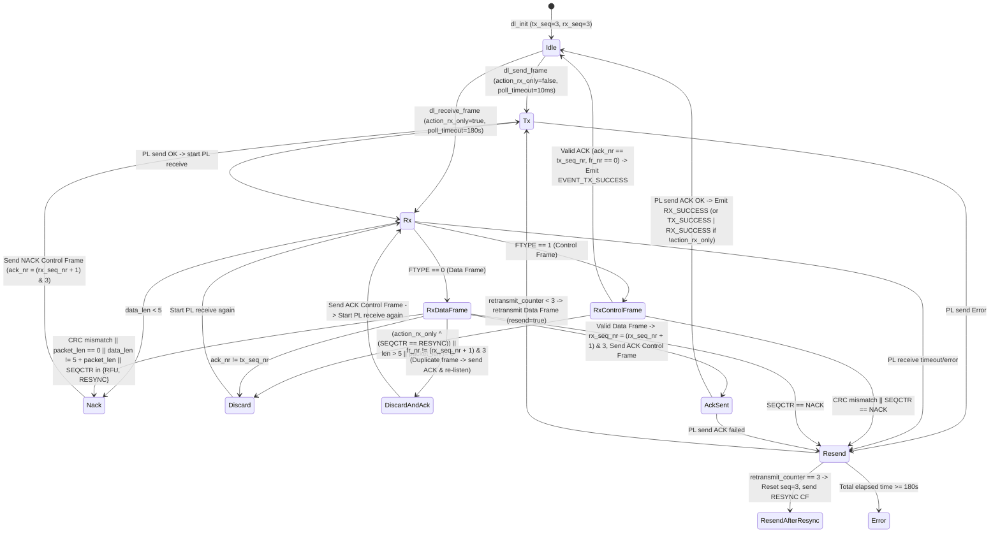

# 02 — Data Link Layer (`ifx_i2c::datalink`) Specification

**Primary C References:**
- [`optiga-trust-m/src/comms/ifx_i2c/ifx_i2c_data_link_layer.c`](file:///Users/chris/Development/optiga/optiga-trust-m/src/comms/ifx_i2c/ifx_i2c_data_link_layer.c)
- [`optiga-trust-m/include/ifx_i2c/ifx_i2c_data_link_layer.h`](file:///Users/chris/Development/optiga/optiga-trust-m/include/ifx_i2c/ifx_i2c_data_link_layer.h)

---

## 1. Overview & Responsibilities

The Data Link Layer (`DataLinkLayer`) provides **error-free, sequence-checked frame delivery** over the Physical Layer. It wraps upper-layer Transport Layer packets (`1..=272` bytes) in a 5-byte framing envelope (`DL_HEADER_SIZE = 5`) consisting of a 1-byte Frame Control header (`FCTR`), a 2-byte big-endian payload length (`LEN`), and a 2-byte trailing Frame Check Sequence (`CRC-16/CCITT`).

Its core responsibilities are:
1. **Frame Encoding & Decoding**: Constructing Data Frames (`FTYPE = 0`) and Control Frames (`FTYPE = 1`), and validating incoming frame lengths and CRCs.
2. **2-Bit Modulo-4 Sequence Number Tracking**: Maintaining `tx_seq_nr` (`0..=3`) and `rx_seq_nr` (`0..=3`).
3. **Automatic Repeat Request (ARQ)**: Retransmitting corrupted or NACKed frames up to `DL_TRANS_REPEAT` ($3$) times, sending explicit Control Frame ACKs for received Data Frames, and issuing `RESYNC` frames when retries are exhausted or when a fatal error occurs.

---

## 2. Wire Frame Format & `FCTR` Bitfield

```text
 0                   1                   2                   3
 0 1 2 3 4 5 6 7 8 9 0 1 2 3 4 5 6 7 8 9 0 1 2 3 4 5 6 7 8 9 0 1
+-+-+-+-+-+-+-+-+-+-+-+-+-+-+-+-+-+-+-+-+-+-+-+-+-+-+-+-+-+-+-+-+
|F|SEQ|0|FRN|ACK|          LEN (16-bit BE)      | Payload ...   |
+-+-+-+-+-+-+-+-+-+-+-+-+-+-+-+-+-+-+-+-+-+-+-+-+-+-+-+-+-+-+-+-+
| ... Payload (0..272 bytes) ...|       FCS / CRC-16 (BE)       |
+-+-+-+-+-+-+-+-+-+-+-+-+-+-+-+-+-+-+-+-+-+-+-+-+-+-+-+-+-+-+-+-+
```

### 2.1 `FCTR` (Byte 0) Layout
| Bit(s) | Mask | Name | Values | Description |
| :---: | :---: | :--- | :--- | :--- |
| `7` | `0x80` | `FTYPE` | `0` = Data Frame (`DF`)<br/>`1` = Control Frame (`CF`) | Control Frames always have `LEN = 0` and total wire size = 5 bytes. |
| `6..=5` | `0x60` | `SEQCTR` | `0b00` (`0`) = `ACK`<br/>`0b01` (`1`) = `NACK`<br/>`0b10` (`2`) = `RESYNC`<br/>`0b11` (`3`) = `RFU` (Invalid) | Sequence control operation. `RESYNC` is only valid in Control Frames (`FTYPE = 1`). |
| `4` | `0x10` | `RFU` | Always `0` | Reserved for future use. |
| `3..=2` | `0x0C` | `FRNR` | `0..=3` | Frame Number of this Data Frame (`0` for Control Frames). |
| `1..=0` | `0x03` | `ACKNR` | `0..=3` | Acknowledged Frame Number (`rx_seq_nr` for `ACK`, `(rx_seq_nr + 1) & 3` for `NACK`, `0` for `RESYNC`). |

```rust
#[derive(Debug, Clone, Copy, PartialEq, Eq)]
pub enum FrameType {
    Data = 0,
    Control = 1,
}

#[derive(Debug, Clone, Copy, PartialEq, Eq)]
#[repr(u8)]
pub enum SeqCtrl {
    Ack = 0x00,
    Nack = 0x01,
    Resync = 0x02,
    Rfu = 0x03,
}

#[derive(Debug, Clone, Copy, PartialEq, Eq)]
pub struct Fctr(pub u8);

impl Fctr {
    pub const fn new(frame_type: FrameType, seq_ctrl: SeqCtrl, fr_nr: u8, ack_nr: u8) -> Self {
        let ftype_bit = (frame_type as u8) << 7;
        let seq_bits = (seq_ctrl as u8 & 0x03) << 5;
        let fr_bits = (fr_nr & 0x03) << 2;
        let ack_bits = ack_nr & 0x03;
        Self(ftype_bit | seq_bits | fr_bits | ack_bits)
    }

    pub const fn frame_type(self) -> FrameType {
        if (self.0 & 0x80) != 0 { FrameType::Control } else { FrameType::Data }
    }

    pub const fn seq_ctrl(self) -> SeqCtrl {
        match (self.0 & 0x60) >> 5 {
            0x00 => SeqCtrl::Ack,
            0x01 => SeqCtrl::Nack,
            0x02 => SeqCtrl::Resync,
            _ => SeqCtrl::Rfu,
        }
    }

    pub const fn fr_nr(self) -> u8 {
        (self.0 & 0x0C) >> 2
    }

    pub const fn ack_nr(self) -> u8 {
        self.0 & 0x03
    }
}
```

---

## 3. CRC-16/CCITT Algorithm Specification

Maps to [`ifx_i2c_dl_calc_crc_byte`](file:///Users/chris/Development/optiga/optiga-trust-m/src/comms/ifx_i2c/ifx_i2c_data_link_layer.c#L224-L248). The CRC is computed over `frame[0 .. 3 + payload_len]` (i.e., `FCTR`, `LEN_MSB`, `LEN_LSB`, and `Payload`) with initial seed `0x0000`, and written big-endian to `frame[3 + payload_len .. 5 + payload_len]`.

```rust
#[inline]
pub const fn crc16_ccitt_byte(seed: u16, byte: u8) -> u16 {
    let h1: u16 = (seed ^ (byte as u16)) & 0x00FF;
    let h2: u16 = h1 & 0x000F;
    let h3: u16 = (h2 << 4) ^ h1;
    let h4: u16 = h3 >> 4;

    (((((h3 << 1) ^ h4) << 4) ^ h2) << 3) ^ h4 ^ (seed >> 8)
}

pub fn crc16_ccitt(data: &[u8]) -> u16 {
    let mut crc: u16 = 0;
    let mut i = 0;
    while i < data.len() {
        crc = crc16_ccitt_byte(crc, data[i]);
        i += 1;
    }
    crc
}
```

---

## 4. State Machine & Sequence Number Invariants

### 4.1 Initialization & Reset (`dl_init` / `resync`)
- `tx_seq_nr = 3` (`DL_MAX_FRAME_NUM`)
- `rx_seq_nr = 3` (`DL_MAX_FRAME_NUM`)
- `resynced = false`
- When sending the **first** new Data Frame (`resend == false` or `self.resynced == true`), `tx_seq_nr` is incremented modulo 4:
  `self.tx_seq_nr = (self.tx_seq_nr + 1) & 0x03;` (so the first Data Frame has `FRNR = 0`, carrying `ACKNR = 3`).
- `self.resynced` is then cleared to `false`.

### 4.2 State Transition Diagram



### 4.3 Subtle C Implementation Behaviors to Preserve
1. **Piggybacked Data Frame vs. Separate ACK Control Frame**:
   - When the master sends the last fragment of a command (`dl_send_frame` with `action_rx_only = false`), the slave may either:
     - **Case A (Separate ACK)**: Send a 5-byte Control Frame (`FTYPE=1, SEQCTR=ACK, ACKNR=tx_seq_nr`). DL transitions to `Idle` and reports `DlEvent::TxSuccess`. The Transport Layer then explicitly calls `dl_receive_frame()` (`action_rx_only = true`, timeout $180\text{ s}$) to wait for the slave's Data Frame response.
     - **Case B (Piggybacked Response)**: Immediately send a Data Frame (`FTYPE=0, SEQCTR=ACK, FRNR=(rx_seq_nr+1)&3, ACKNR=tx_seq_nr`). DL increments `rx_seq_nr`, sends a 5-byte ACK Control Frame back to the slave (`DL_STATE_ACK`), and reports `DlEvent::TxAndRxSuccess` (`IFX_I2C_DL_EVENT_TX_SUCCESS | IFX_I2C_DL_EVENT_RX_SUCCESS`) so TL knows it already has the response frame!
2. **Duplicate Frame Handling ([`ifx_i2c_data_link_layer.c:440-447`](file:///Users/chris/Development/optiga/optiga-trust-m/src/comms/ifx_i2c/ifx_i2c_data_link_layer.c#L440-L447))**:
   - If a Data Frame arrives with valid CRC, but `fr_nr != (rx_seq_nr + 1) & 3` (e.g., the slave didn't receive our previous ACK and retransmitted its Data Frame), the master **sends an ACK Control Frame** (using `rx_frame_buffer` so `tx_frame_buffer` is preserved) and transitions to `DL_STATE_DISCARD` (which immediately starts receiving the next frame).
3. **`action_rx_only ^ (SEQCTR == RESYNC)` Check ([`ifx_i2c_data_link_layer.c:481`](file:///Users/chris/Development/optiga/optiga-trust-m/src/comms/ifx_i2c/ifx_i2c_data_link_layer.c#L481-L486))**:
   - In Receiver Mode (`action_rx_only == true`), all Control Frames *except* `RESYNC` are discarded (`DL_STATE_DISCARD`).
   - In Transmit Mode (`action_rx_only == false`), a `RESYNC` Control Frame from the slave is discarded (`DL_STATE_DISCARD`).
4. **Fatal Error Recovery ([`ifx_i2c_data_link_layer.c:576-594`](file:///Users/chris/Development/optiga/optiga-trust-m/src/comms/ifx_i2c/ifx_i2c_data_link_layer.c#L576-L594))**:
   - When entering `DL_STATE_ERROR` (e.g., after `IFX_I2C_FATAL_ERROR` or timeout) and `resynced == 0`, DL attempts to send one `RESYNC` Control Frame to the slave before reporting `IFX_I2C_DL_EVENT_ERROR` to the Transport Layer.
