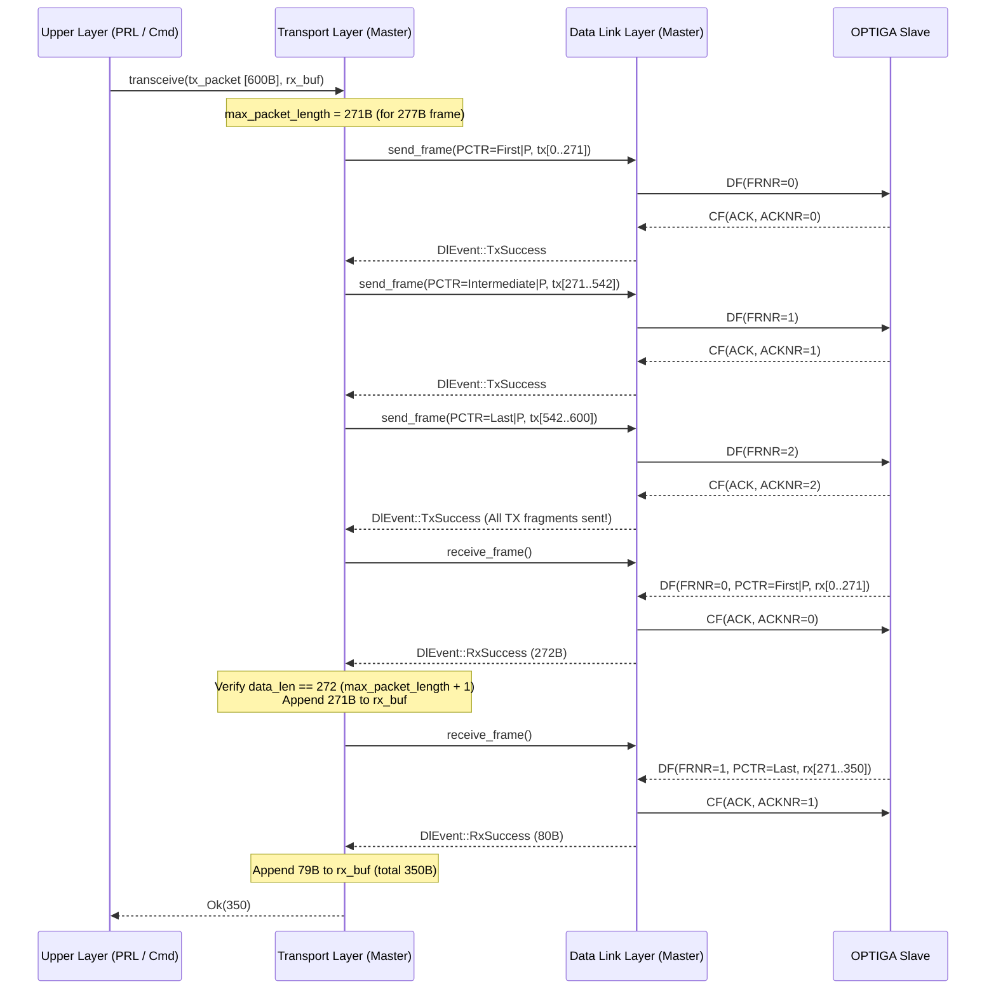

# 03 — Transport Layer (`ifx_i2c::transport`) Specification

**Primary C References:**
- [`optiga-trust-m/src/comms/ifx_i2c/ifx_i2c_transport_layer.c`](file:///Users/chris/Development/optiga/optiga-trust-m/src/comms/ifx_i2c/ifx_i2c_transport_layer.c)
- [`optiga-trust-m/include/ifx_i2c/ifx_i2c_transport_layer.h`](file:///Users/chris/Development/optiga/optiga-trust-m/include/ifx_i2c/ifx_i2c_transport_layer.h)

---

## 1. Overview & Responsibilities

The Transport Layer (`TransportLayer`) segments large upper-layer packets (APDUs or Presentation Layer frames up to $1570\text{ bytes}$) into Data Link Layer payloads of at most `max_packet_length = frame_size - (DL_HEADER_SIZE + TL_HEADER_SIZE) = frame_size - 6` bytes ($271\text{ bytes}$ when `frame_size == 277`), and reassembles multi-fragment responses from the slave.

Each Transport Layer fragment prepends a 1-byte **Packet Control (`PCTR`)** header (`TL_HEADER_SIZE = 1`).

---

## 2. `PCTR` Header Format & Chaining State Machine

```text
  Bit 7   Bit 6   Bit 5   Bit 4   Bit 3          Bit 2   Bit 1   Bit 0
+-------+-------+-------+-------+--------------+-------+-------+-------+
|   Channel / Reserved (0b0000) | Presence (P) |    Chaining (CHAIN)   |
+-------+-------+-------+-------+--------------+-------+-------+-------+
|<--------- Mask 0xF8 --------->|   Bit 0x08   |<----- Mask 0x07 ----->|
```

- **Presence Bit (`0x08`)**:
  - `0x08` (`true`) when Presentation Layer (Shielded Connection) is enabled (`OPTIGA_COMMS_SHIELDED_CONNECTION`).
  - `0x00` (`false`) when communicating in raw unprotected mode without the Presentation Layer.
  - **Presence Bit Validation ([`presence_bit_check` in `ifx_i2c_transport_layer.c:212-234`](file:///Users/chris/Development/optiga/optiga-trust-m/src/comms/ifx_i2c/ifx_i2c_transport_layer.c#L212-L234))**:
    - When Presentation Layer is enabled (`presence_bit == true`), incoming `NO` (`0x00`) and `FIRST` (`0x01`) fragments must have `(pctr & 0xF8) == 0x08` (intermediate/last fragments do not carry the presence bit on the slave response).
    - When Presentation Layer is disabled (`presence_bit == false`), all incoming fragments must have `(pctr & 0xF8) == 0x00`.
- **Chaining Field (`pctr & 0x07`)**:
  ```rust
  #[derive(Debug, Clone, Copy, PartialEq, Eq)]
  #[repr(u8)]
  pub enum ChainState {
      No = 0x00,
      First = 0x01,
      Intermediate = 0x02,
      Last = 0x04,
      Error = 0x07,
  }
  ```

### 2.1 Valid Chaining State Transitions (`g_pctr_states_table`)
When receiving fragments from the slave, `previous_chaining` initializes to `ChainState::No` (`0x00`). Each received fragment's `current_chaining` (`pctr & 0x07`) is validated against `previous_chaining` per [`g_pctr_states_table` in `ifx_i2c_transport_layer.c:51-61`](file:///Users/chris/Development/optiga/optiga-trust-m/src/comms/ifx_i2c/ifx_i2c_transport_layer.c#L51-L61):

| Incoming `current_chaining` | Allowed `previous_chaining` Values | Next State |
| :--- | :--- | :--- |
| `ChainState::No` (`0x00`) | `No` (`0x00`) or `Last` (`0x04`) | Complete (`Idle`) |
| `ChainState::First` (`0x01`) | `No` (`0x00`) or `Last` (`0x04`) | `Chaining` (must have `data_len == max_packet_length + 1`) |
| `ChainState::Intermediate` (`0x02`) | `First` (`0x01`) or `Intermediate` (`0x02`) | `Chaining` (must have `data_len == max_packet_length + 1`) |
| `ChainState::Last` (`0x04`) | `First` (`0x01`) or `Intermediate` (`0x02`) | Complete (`Idle`) |
| `ChainState::Error` (`0x07`) | `Error` (`0x07`) | Triggers `Resend` |
| Any other (`0x03`, `0x05`, `0x06`) | None (Invalid) | Triggers `Resend` |

---

## 3. Fragmentation & Reassembly Flow



---

## 4. Edge Cases & Error Recovery Rules

1. **Fragment Calculation on TX ([`ifx_i2c_tl_calculate_pctr`](file:///Users/chris/Development/optiga/optiga-trust-m/src/comms/ifx_i2c/ifx_i2c_transport_layer.c#L142-L164))**:
   - Let `remaining = tx_packet.len() - packet_offset`.
   - `packet_offset == 0 && remaining <= max_packet_length` $\rightarrow$ `ChainState::No` (`0x00`).
   - `packet_offset == 0 && remaining > max_packet_length` $\rightarrow$ `ChainState::First` (`0x01`).
   - `packet_offset != 0 && remaining > max_packet_length` $\rightarrow$ `ChainState::Intermediate` (`0x02`).
   - `packet_offset != 0 && remaining <= max_packet_length` $\rightarrow$ `ChainState::Last` (`0x04`).
   - Note: On TX, the master ORs `IFX_I2C_PRESENCE_BIT` (`0x08`) into **every** outgoing fragment's `PCTR` ([`ifx_i2c_transport_layer.c:175`](file:///Users/chris/Development/optiga/optiga-trust-m/src/comms/ifx_i2c/ifx_i2c_transport_layer.c#L175)).
2. **Early Data Reception Error During Multi-Fragment TX ([`ifx_i2c_transport_layer.c:273-283`](file:///Users/chris/Development/optiga/optiga-trust-m/src/comms/ifx_i2c/ifx_i2c_transport_layer.c#L273-L283))**:
   - While `packet_offset < tx_packet.len()`:
     - If the slave responds with `chaining == ChainState::Error` (`0x07`), transition to `TL_STATE_RESEND` (restart sending from `packet_offset = 0`, allowed once via `chaining_error_count`).
     - If the slave sends any other data (`data_len != 0`) before all TX fragments are sent, abort with `IfxI2cError::ProtocolError`.
3. **Strict Length Check on `First` and `Intermediate` RX Fragments ([`ifx_i2c_transport_layer.c:387`](file:///Users/chris/Development/optiga/optiga-trust-m/src/comms/ifx_i2c/ifx_i2c_transport_layer.c#L387-L391))**:
   - When entering `TL_STATE_CHAINING` (i.e., `chaining` is `First` or `Intermediate`), the received TL payload (`data_len` including the 1-byte `PCTR`) **must** equal `max_packet_length + 1`. If it is shorter or longer, transition to `TL_STATE_CHAINING_ERROR` (send `[0x07]` chaining error frame once via `master_chaining_error_count`).
4. **Receive Buffer Overflow Draining ([`ifx_i2c_transport_layer.c:321-330, 350-356, 393-399`](file:///Users/chris/Development/optiga/optiga-trust-m/src/comms/ifx_i2c/ifx_i2c_transport_layer.c#L321-L330))**:
   - If `total_recv_length + (data_len - 1) > rx_buf.len()`:
     - Set `error_event = IfxI2cError::MemoryInsufficient`.
     - If the overflow happens on `ChainState::No` or `ChainState::Last`, immediately exit and return `Err(IfxI2cError::MemoryInsufficient)`.
     - If the overflow happens on `ChainState::First` or `ChainState::Intermediate`, **do not copy** into `rx_buf`, but continue calling `dl.receive_frame()` to drain remaining chained fragments from the slave until `ChainState::Last` is received, then return `Err(IfxI2cError::MemoryInsufficient)`.
