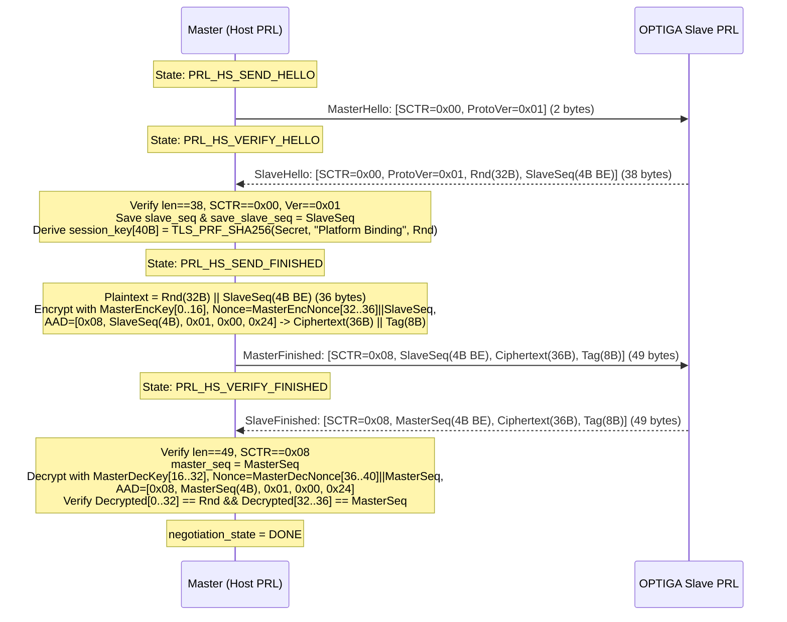

# 04 — Presentation Layer (`ifx_i2c::presentation`) Specification

**Primary C References:**
- [`optiga-trust-m/src/comms/ifx_i2c/ifx_i2c_presentation_layer.c`](file:///Users/chris/Development/optiga/optiga-trust-m/src/comms/ifx_i2c/ifx_i2c_presentation_layer.c)
- [`optiga-trust-m/include/ifx_i2c/ifx_i2c_presentation_layer.h`](file:///Users/chris/Development/optiga/optiga-trust-m/include/ifx_i2c/ifx_i2c_presentation_layer.h)
- [`optiga-trust-m/extras/pal/pal_crypt_psa.c`](file:///Users/chris/Development/optiga/optiga-trust-m/extras/pal/pal_crypt_psa.c)

---

## 1. Overview & Responsibilities

The Presentation Layer (`PresentationLayer`) implements **OPTIGA™ Shielded Connection** (Infineon I2C Protocol v2.03 Presentation Layer, Protocol Version `0x01` = Pre-Shared Secret). It sits between the Command Layer (`optiga_cmd`) and the Transport Layer (`ifx_i2c::transport`) and provides:
1. **Mutual Authentication & Session Key Derivation**: A 4-message handshake (`MasterHello` $\rightarrow$ `SlaveHello` $\rightarrow$ `MasterFinished` $\rightarrow$ `SlaveFinished`) using a pre-shared platform binding secret (`DatastoreId::PlatformBindingSharedSecret`, ID `0x11`) and **TLS 1.2 PRF (HMAC-SHA256)**.
2. **Authenticated Encryption (Record Exchange)**: Per-command configurable protection (`NoProtection`, `MasterProtection`, `SlaveProtection`, `FullProtection`) using **AES-128-CCM-8** (128-bit key, 8-byte nonce, 8-byte AAD, 8-byte MAC tag) and strictly monotonic 32-bit sequence numbers with automatic re-keying at `0xFFFFFFF0`.
3. **Alert Handling & Integrity Retransmission**: Detecting decryption/MAC failures, sending `IntegrityViolated` (`0x44`) alerts, and re-encrypting/retransmitting up to `PRL_TRANS_REPEAT` ($3$) times when the slave reports an integrity alert.
4. **Session Context Save & Restore (Manage Context)**: Saving and restoring active session keys and sequence numbers across OPTIGA hibernate cycles (`0x60`/`0x64` and `0x68`/`0x6C`).

---

## 2. `SCTR` (Security Control Byte) Specification

Every Presentation Layer packet starts with a 1-byte `SCTR` header:

```text
  Bit 7   Bit 6   Bit 5   Bit 4   Bit 3   Bit 2   Bit 1   Bit 0
+-------+-------+-------+-------+-------+-------+-------+-------+
|     Protocol Type     |      Message Type     |Protection Lvl |
+-------+-------+-------+-------+-------+-------+-------+-------+
|<----- Mask 0xE0 ----->|<----- Mask 0x1C ----->|<-- Mask 0x03 >|
```

| Protocol Type (`sctr & 0xE0`) | Message Type (`sctr & 0x1C`) | Protection (`sctr & 0x03`) | Combined `SCTR` Byte | Meaning |
| :--- | :--- | :--- | :---: | :--- |
| `0x00` (`HANDSHAKE`) | `0x00` (`HELLO`) | `0x00` | `0x00` | `MasterHello` (2B) / `SlaveHello` (38B) |
| `0x00` (`HANDSHAKE`) | `0x08` (`FINISHED`) | `0x00` | `0x08` | `MasterFinished` (49B) / `SlaveFinished` (49B) |
| `0x20` (`RECORD_EXCHANGE`) | `0x00` (Data Record) | `0x00..=0x03` | `0x20..=0x23` | Unprotected (`0x20`), Master (`0x21`), Slave (`0x22`), Full (`0x23`) |
| `0x40` (`ALERT`) | `0x00` (`FATAL_ALERT`) | `0x00` | `0x40` | Fatal Alert (1B) — Terminates session |
| `0x40` (`ALERT`) | `0x04` (`INTEGRITY_VIOLATED`) | `0x00` | `0x44` | Integrity Violated Alert (1B) — Triggers retransmit |
| `0x60` (`MANAGE_CONTEXT`) | `0x00` (`SAVE_CONTEXT`) | `0x00` | `0x60` | Master requests slave to save session context (1B) |
| `0x60` (`MANAGE_CONTEXT`) | `0x04` (`CONTEXT_SAVED`) | `0x00` | `0x64` | Slave confirms context saved (1B) |
| `0x60` (`MANAGE_CONTEXT`) | `0x08` (`RESTORE_CONTEXT`) | `0x00` | `0x68` | Master requests slave to restore session (`[0x68, SlaveSeq(4B)]`, 5B) |
| `0x60` (`MANAGE_CONTEXT`) | `0x0C` (`CONTEXT_RESTORED`) | `0x00` | `0x6C` | Slave confirms context restored (5B) |

```rust
#[derive(Debug, Clone, Copy, PartialEq, Eq)]
#[repr(u8)]
pub enum ProtectionLevel {
    None = 0x00,
    Master = 0x01,
    Slave = 0x02,
    Full = 0x03,
}

#[derive(Debug, Clone, Copy, PartialEq, Eq)]
pub struct ProtectionConfig {
    pub level: ProtectionLevel,
    /// Equivalent to bitwise-OR with `RE_ESTABLISH` (`0x80`).
    pub force_reestablish: bool,
}
```

---

## 3. Cryptographic Key Schedule & AES-128-CCM-8 Construction

### 3.1 Session Key Derivation (`ifx_i2c_prl_prf`)
During the handshake, the slave sends a 32-byte random value `Rnd[0..32]` in `SlaveHello`.
The master reads the pre-shared secret `Secret` (up to 64 bytes) from `DatastoreId::PlatformBindingSharedSecret` (`0x11`) and computes a **40-byte (`0x28`) session key block** using **TLS 1.2 PRF with HMAC-SHA256** (RFC 5246 Section 5):

$$\text{session\_key}[0..40] = \text{PRF}_{\text{SHA256}}\left(\text{secret} = \text{Secret},\ \text{label} = \text{"Platform Binding"},\ \text{seed} = \text{Rnd}[0..32]\right)$$

> [!IMPORTANT]
> The ASCII label `"Platform Binding"` is **16 bytes** long (do **not** include a trailing C null terminator `\0`, see `sizeof(label_input) - 1` in [`ifx_i2c_presentation_layer.c:306`](file:///Users/chris/Development/optiga/optiga-trust-m/src/comms/ifx_i2c/ifx_i2c_presentation_layer.c#L301-L312)).

The 40-byte `session_key` is sliced as follows:
| Slice Range | Offset Constant | Length | Purpose |
| :---: | :--- | :---: | :--- |
| `session_key[0..16]` | `PRL_MASTER_ENCRYPTION_KEY_OFFSET` (`0x00`) | 16B | Master Encryption Key (and Master Retransmit Decryption Key) |
| `session_key[16..32]` | `PRL_MASTER_DECRYPTION_KEY_OFFSET` (`0x10`) | 16B | Master Decryption Key (Slave Encryption Key) |
| `session_key[32..36]` | `PRL_MASTER_ENCRYPTION_NONCE_OFFSET` (`0x20`) | 4B | Master Encryption Nonce High 4 Bytes |
| `session_key[36..40]` | `PRL_MASTER_DECRYPTION_NONCE_OFFSET` (`0x24`) | 4B | Master Decryption Nonce High 4 Bytes |

### 3.2 Nonce (8 Bytes) & Associated Data (8 Bytes)
For every AES-128-CCM-8 encryption or decryption operation (both `Handshake Finished` messages and `Record Exchange` messages):
- **8-Byte Nonce (`nonce_data[0..8]`)**:
  ```text
  +-----------------------------------+-----------------------------------+
  | Nonce Prefix (4B from session_key)|     Sequence Number (4B u32 BE)   |
  +-----------------------------------+-----------------------------------+
  ```
- **8-Byte Associated Data (`associate_data[0..8]`)** ([`ifx_i2c_prl_form_associated_data`](file:///Users/chris/Development/optiga/optiga-trust-m/src/comms/ifx_i2c/ifx_i2c_presentation_layer.c#L321-L331)):
  ```text
  +----------+------------------------+---------------+-------------------+
  | SCTR (1B)| Seq Number (4B u32 BE) | ProtoVer (1B) | Plaintext Len (2B)|
  +----------+------------------------+---------------+-------------------+
    byte 0         bytes 1..=4          byte 5 (0x01)   bytes 6..=7 (BE)
  ```
  *Note*: `Plaintext Len` (`data_len`) is always the **unencrypted payload length** (excluding the 5-byte PRL header and excluding the 8-byte MAC tag). For `Finished` handshake messages, `Plaintext Len` is `36` (`0x0024` = 32B `Rnd` + 4B `SeqNr`).

---

## 4. Handshake Protocol State Machine (`ifx_i2c_prl_do_handshake`)



---

## 5. Record Exchange Protocol & Clean Buffer Encapsulation

### 5.1 Eliminating C's 5-Byte Offset Hack
In C, callers of `ifx_i2c_prl_transceive` had to pass a buffer with 5 dummy bytes at the front (`IFX_I2C_DATA_OFFSET = 5`) and 8 dummy bytes at the end (`IFX_I2C_PRL_MAC_SIZE = 8`).
In Rust, `PresentationLayer` owns an internal record buffer `record_buf: [u8; OPTIGA_MAX_COMMS_BUFFER_SIZE + PRL_OVERHEAD_SIZE]` ($1557 + 13 = 1570\text{ bytes}$):

1. **Sequence Number Rollover Pre-Check**:
   - Before sending a record:
     - If Slave or Full protection is enabled and `self.save_slave_sequence_number + 1 > 0xFFFFFFF0` (`PRL_SEQUENCE_THRESHOLD`), automatically trigger a new handshake (`do_handshake`) first!
     - If Master or Full protection is enabled and `self.master_sequence_number + 1 > 0xFFFFFFF0`, automatically trigger a new handshake first!
2. **Master TX Framing**:
   - Form `sctr = 0x20 | (protection_level as u8 & 0x03)` and store in `self.saved_sctr`.
   - **If `protection_level` is `Master` (`0x01`) or `Full` (`0x03`)**:
     - `self.master_sequence_number += 1;`
     - Write header into `record_buf[0..5]`: `record_buf[0] = sctr`, `record_buf[1..5] = self.master_sequence_number.to_be_bytes()`.
     - Copy `tx_payload` into `record_buf[5 .. 5 + tx_payload.len()]`.
     - Encrypt `record_buf[5 .. 5 + tx_payload.len()]` in-place with `MasterEncKey`, `MasterEncNonce || master_sequence_number`, AAD `[sctr, master_seq(4B), 0x01, tx_len(2B)]`, and write the 8-byte tag to `record_buf[5 + tx_payload.len() .. 13 + tx_payload.len()]`.
     - Total TX length sent to Transport Layer: `tx_payload.len() + 13`.
   - **If `protection_level` is `None` (`0x00`) or `Slave` (`0x02`)**:
     - `record_buf[0] = sctr`.
     - Copy `tx_payload` into `record_buf[1 .. 1 + tx_payload.len()]`.
     - Total TX length sent to Transport Layer: `tx_payload.len() + 1`.
3. **Slave RX Verification (`PRL_STATE_VERIFY`)**:
   - Receive response from Transport Layer into `record_buf` (yielding `rx_raw_len` bytes).
   - Check if `record_buf[0] & 0x40 != 0` (`PRL_ALERT_PROTOCOL`):
     - If `record_buf[0] == 0x44` (`PRL_ALERT_PROTOCOL | PRL_INTEGRITY_VIOLATED_ALERT_MSG`) and `rx_raw_len == 1` and `protection_level` includes Master protection and `data_retransmit_counter < 3`:
       - Increment `data_retransmit_counter`, increment `master_sequence_number`, re-encrypt original `tx_payload` with the new `master_sequence_number`, and retransmit!
     - Otherwise, invalidate session (`negotiation_state = NOT_DONE`) and return `Err(IfxI2cError::SessionError)`.
   - Verify `record_buf[0] == self.saved_sctr`. If mismatch, invalidate session and return `Err(IfxI2cError::SessionError)`.
   - **If `protection_level` is `Slave` (`0x02`) or `Full` (`0x03`)**:
     - Verify `rx_raw_len > 13` (`PRL_HEADER_SIZE + PRL_MAC_SIZE`).
     - Parse `slave_seq = u32::from_be_bytes(record_buf[1..5])`.
     - Verify sequence window: `slave_seq > self.save_slave_sequence_number` AND `slave_seq <= self.save_slave_sequence_number + 3` (`PRL_TRANS_REPEAT`). If outside window, invalidate session and return `Err(IfxI2cError::SessionError)`.
     - Update `self.save_slave_sequence_number = slave_seq`.
     - Let `plain_len = rx_raw_len - 13`.
     - Decrypt `record_buf[5 .. 5 + plain_len]` with tag `record_buf[5 + plain_len .. 13 + plain_len]` using `MasterDecKey`, `MasterDecNonce || slave_seq`, AAD `[saved_sctr, slave_seq(4B), 0x01, plain_len(2B)]`.
     - If decryption/MAC fails:
       - If `decryption_failure_counter < 3`:
         - `decryption_failure_counter += 1`.
         - Send 1-byte Integrity Violated Alert `[0x44]` via `tl.transceive(&[0x44], &mut record_buf)` and loop back to `PRL_STATE_VERIFY` to verify the slave's retransmitted response!
       - Else invalidate session and return `Err(IfxI2cError::SessionError)`.
     - Copy decrypted `record_buf[5 .. 5 + plain_len]` to caller's `rx_payload[..plain_len]` and return `Ok(plain_len)`.
   - **If `protection_level` is `None` (`0x00`) or `Master` (`0x01`)**:
     - Verify `rx_raw_len > 1`.
     - Copy `record_buf[1 .. rx_raw_len]` to caller's `rx_payload[..rx_raw_len - 1]` and return `Ok(rx_raw_len - 1)`.

---

## 6. Manage Context (Session Save & Restore)

Maps to [`ifx_i2c_prl_do_manage_context`](file:///Users/chris/Development/optiga/optiga-trust-m/src/comms/ifx_i2c/ifx_i2c_presentation_layer.c#L623-L777):
- **Save Context (`ManageContextOp::Save` during `ifx_i2c_close`)**:
  1. Send 1-byte `[0x60]` (`PRL_SAVE_CONTEXT_MSG`) via Transport Layer.
  2. Verify slave responds with 1-byte `[0x64]` (`PRL_CONTEXT_SAVED_MSG`, masked with `0xFC`).
  3. Serialize `SavedSecContext { session_key, master_sequence_number, save_slave_sequence_number, decryption_failure_counter, data_retransmit_counter, negotiation_state, stored_context_flag: true }` to `DatastoreId::ManageContext` (`0x22`).
  4. Zeroize active session context (`CLEAR_SESSION_CONTEXT`).
- **Restore Context (`ManageContextOp::Restore` at start of next `transceive`)**:
  1. Read `SavedSecContext` from `DatastoreId::ManageContext` (`0x22`).
  2. Send 5-byte `[0x68, save_slave_sequence_number.to_be_bytes()]` (`PRL_RESTORE_CONTEXT_MSG`) via Transport Layer, and clear stored context in Datastore.
  3. Verify slave responds with 5-byte message where `byte[0] & 0xFC == 0x6C` (`PRL_CONTEXT_RESTORED_MSG`).
  4. Copy `SavedSecContext` into active `PresentationLayer` state and proceed directly to `PRL_STATE_TXRX` without a new handshake!
