# 06 — Host Simulation (`optiga-sim`) & Testing Strategy

**Primary C References:**
- [`optiga-trust-m/tests/`](file:///Users/chris/Development/optiga/optiga-trust-m/tests)
- [`optiga-trust-m/extras/pal/test_pal/`](file:///Users/chris/Development/optiga/optiga-trust-m/extras/pal/test_pal)

---

## 1. Why `optiga-sim` Replaces `extras/pal/test_pal`

In the C reference repository, [`extras/pal/test_pal/pal_i2c.c`](file:///Users/chris/Development/optiga/optiga-trust-m/extras/pal/test_pal/pal_i2c.c) is a trivial stub: `pal_i2c_write` and `pal_i2c_read` do not inspect or modify `p_data` at all—they immediately invoke `PAL_I2C_EVENT_SUCCESS`. Consequently, the C unit tests in [`tests/ifx_i2c_unit_test.c`](file:///Users/chris/Development/optiga/optiga-trust-m/tests/ifx_i2c_unit_test.c) only test the initial call entry points and never test the asynchronous state machine transitions, register negotiations, CRC validation, sequence number wrapping, TL fragmentation, or PRL handshakes!

To achieve **100% host-first confidence before moving to real hardware**, we build **`optiga-sim`**: a full, stateful **Virtual OPTIGA Trust M Slave Emulator** and **Deterministic Fault-Injecting I2C Bus**.

---

## 2. Architecture of `VirtualOptiga` (`crates/optiga-sim`)

```mermaid
flowchart LR
    subgraph HostDriver ["optiga-trust-m (Under Test)"]
        Master["IfxI2cStack / OptigaCmd / Util / Crypt"]
    end

    subgraph FaultProxy ["FaultInjectingI2cBus"]
        Rules["Programmable Fault Rules:<br/>- NackNextN(count)<br/>- CorruptDlCrcOnFrame(n)<br/>- DropSlaveAckOnFrame(n)<br/>- FlipPrlCiphertextBit(n)<br/>- ViolateGuardTimeCheck"]
    end

    subgraph VirtualSlave ["VirtualOptiga (Stateful Slave Emulator)"]
        Reg["Register File (0x80..0x89)<br/>+ Guard Time Verifier (50us)"]
        SlaveDL["Slave DL: CRC-16 check,<br/>FRNR/ACKNR modulo-4, ACK/NACK/RESYNC"]
        SlaveTL["Slave TL: PCTR Reassembly<br/>& Response Fragmentation"]
        SlavePRL["Slave PRL: SlaveHello, TLS-PRF-SHA256,<br/>AES-128-CCM-8, Context Save/Restore"]
        SlaveAPDU["Virtual APDU Engine:<br/>Data Objects, RNG, ECC/RSA/AES, 0xF1C2 Error Reg"]
    end

    Master -->|OptigaI2cBus + DelayNs| FaultProxy
    FaultProxy -->|I2C Read/Write + Virtual Clock| Reg
    Reg <--> SlaveDL
    SlaveDL <--> SlaveTL
    SlaveTL <--> SlavePRL
    SlavePRL <--> SlaveAPDU
```

### 2.1 `VirtualOptiga` Register & Timing Invariant Enforcement
`VirtualOptiga` shares a reference to `SimulatedClock` (which advances whenever the driver calls `DelayNs::delay_us` or `delay_ms`):
1. **Strict Guard Time Assertion**: `VirtualOptiga` records `last_bus_activity_us`. If the master issues an I2C `write` or `read` when `clock.now_us() - last_bus_activity_us < 50`, `VirtualOptiga` panics (or records a `GuardTimeViolation` error) in tests, proving that our Physical Layer never violates the $50\ \mu\text{s}$ guard time!
2. **Strict Reset Timing Assertion**: `VirtualOptiga` monitors the virtual `VDD` and `RST` `OutputPin` states. It verifies that `RST` is held low for $\ge 2000\ \mu\text{s}$ and that no I2C traffic arrives for $\ge 12000\ \mu\text{s}$ after `RST` goes high (or after `0x88` `SOFT_RESET` is written).
3. **Register File Simulation**:
   - `0x81` (`DATA_REG_LEN`): Initializes to `277` (`0x0115`). Accepts writes `16..=277` (or can be configured to clamp to e.g. `64` to test down-negotiation).
   - `0x82` (`I2C_STATE`): Dynamically computes `[flags, 0x00, resp_len_msb, resp_len_lsb]` where `flags` sets `0x40` (`RESPONSE_READY`) whenever the Slave DL queue has a pending frame to send to the master, and `0x08` (`SOFT_RESET` supported).
   - `0x84` (`MAX_SCL_FREQU`): Returns `[0x00, 0x00, 0x01, 0x90]` ($400\text{ kHz}$) when `I2C_MODE == 0x03` (SM/FM), and `[0x00, 0x00, 0x03, 0xE8]` ($1000\text{ kHz}$) when `I2C_MODE == 0x04` (FM+).
   - `0x80` (`DATA`): Writing to `0x80` feeds the bytes (`[0x80, frame...]`) into the Slave DL engine. Reading from `0x80` pops the next queued Slave DL frame.

---

## 3. Four-Tier Verification Matrix

### Tier 1: Pure Unit & Property Tests (Fast, Stateless)
- **CRC-16/CCITT**: Verify `crc16_ccitt` against C test vectors and verify that all 1-bit and 2-bit errors in a 277-byte frame alter the CRC.
- **Bitfield Codecs**: Exhaustive roundtrip tests for `Fctr`, `Pctr`, `Sctr`, and `I2cStateStatus`.
- **HostCrypto**: Test `RustCryptoBackend` against RFC 5246 TLS-1.2 PRF SHA-256 test vectors and NIST SP 800-38C AES-128-CCM-8 test vectors.

### Tier 2: Happy-Path Full-Stack Simulation Tests
- **`test_pl_cold_warm_soft_reset_and_negotiation`**: Verify 100 kHz $\rightarrow$ 400 kHz (SM/FM) and 100 kHz $\rightarrow$ 1000 kHz (FM+) negotiation, plus `DATA_REG_LEN` negotiation (277B and 64B).
- **`test_dl_sequence_rollover_and_piggyback_vs_separate_ack`**: Send 16 consecutive frames verifying `FRNR` and `ACKNR` cycle `0 -> 1 -> 2 -> 3 -> 0` under both Separate ACK (Control Frame then Data Frame) and Piggybacked Data Frame modes.
- **`test_tl_large_apdu_fragmentation_and_reassembly`**: Transceive a 1500-byte payload over a 64-byte frame size (requiring 26 fragments) and verify exact byte-for-byte reconstruction.
- **`test_prl_shielded_connection_all_protection_levels`**: Complete `MasterHello`/`SlaveHello`/`MasterFinished`/`SlaveFinished` handshake using the 64-byte default shared secret from [`pal_os_datastore.c`](file:///Users/chris/Development/optiga/optiga-trust-m/extras/pal/test_pal/pal_os_datastore.c#L31-L100), followed by APDUs under `None`, `Master`, `Slave`, and `Full` protection, plus `Save`/`Restore` context across hibernate.
- **`test_cmd_util_crypt_workflows`**: End-to-end `OpenApplication`, `read_data`, `write_data`, `get_random`, `ecc_generate_keypair` (with `SessionSlot`), `ecdsa_sign`, `ecdsa_verify`, and `0xF1C2` automatic device error retrieval when `VirtualOptiga` returns `Sta = 0xFF`.

### Tier 3: Adversarial Fault Injection Tests (`FaultInjectingI2cBus`)
| Test Case | Injected Fault | Expected Driver Behavior |
| :--- | :--- | :--- |
| `test_pl_sleep_nack_recovery` | Slave NACKs first 25 I2C writes | PL polls every $1\text{ ms}$ and succeeds on attempt 26. |
| `test_pl_nack_exhaustion` | Slave NACKs 201 consecutive I2C writes | PL aborts after 200 retries with `Err(IfxI2cError::FatalError)`. |
| `test_dl_rx_crc_corruption_nack_recovery` | Flip 1 bit in Slave Data Frame #2 | Master sends `NACK` CF (`ACKNR = expected_seq`), Slave retransmits Data Frame #2, transaction succeeds. |
| `test_dl_tx_nack_retransmit_and_resync` | Slave replies with `NACK` CF 3 times in a row | Master retransmits 3 times, then sends `RESYNC` CF (`SEQCTR=0b10`), resets `tx_seq_nr=3, rx_seq_nr=3`, and recovers. |
| `test_tl_rx_buffer_overflow_drains_chain` | Slave sends 3-fragment response (600B) into a 400B caller buffer | Master drains all 3 fragments without buffer overrun and returns `Err(IfxI2cError::MemoryInsufficient)`. |
| `test_prl_slave_mac_corruption_alert_retry` | Corrupt 1 byte of Slave encrypted record #1 | Master AES-CCM decrypt fails, sends `IntegrityViolated` alert (`0x44`), Slave retransmits with incremented `SlaveSeq`, Master decrypts and succeeds. |
| `test_prl_sequence_threshold_renegotiation` | Set `master_sequence_number = 0xFFFFFFF0` | Master automatically performs a fresh Handshake before encrypting and sending the next record. |

### Tier 4: Optional C-to-Rust Differential FFI Test
By compiling the unmodified C source files (`ifx_i2c_*.c`) into a test-only static library in `optiga-sim` and providing `extern "C"` hooks for `pal_i2c_*`, `pal_os_event_*`, and `pal_os_timer_*` backed by `VirtualOptiga`:
- Run the exact same transactions through the C `ifx_i2c` stack and the Rust `ifx_i2c` stack, asserting **100% byte-identical I2C bus traces**.
