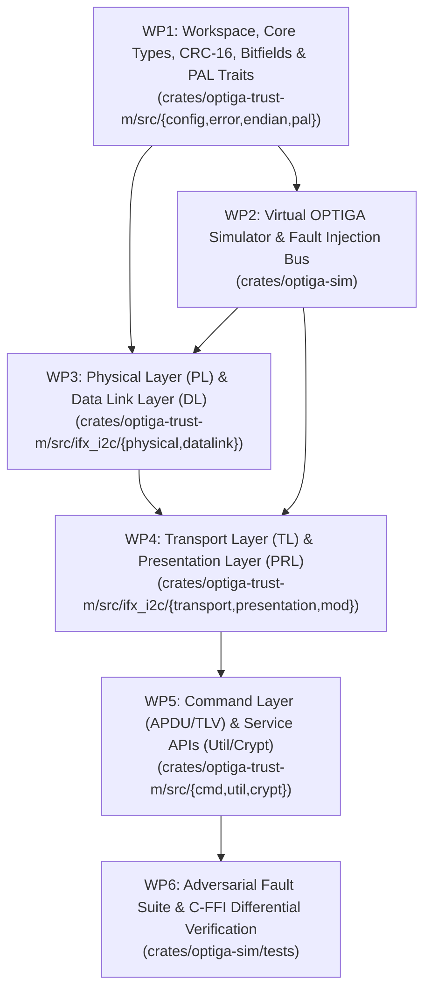

# 07 — Phased Task Breakdown & Agent Execution Guide

This document breaks the implementation into self-contained, dependency-ordered **Work Packages (WPs)** so multiple models or subagents can implement and verify modules independently without stepping on each other's files.

---

## Dependency Graph

---

## Work Package Specifications

### WP1: Workspace Scaffolding, Wire Primitives & PAL Traits
- **Reference Docs**: [`00_MASTER_ARCHITECTURE.md`](file:///Users/chris/Development/optiga/docs/architecture/00_MASTER_ARCHITECTURE.md), [`02_DATA_LINK_LAYER_DL.md`](file:///Users/chris/Development/optiga/docs/architecture/02_DATA_LINK_LAYER_DL.md)
- **Target Files**:
  - `Cargo.toml`
  - `crates/optiga-trust-m/Cargo.toml`
  - `crates/optiga-trust-m/src/{lib.rs, config.rs, error.rs, endian.rs}`
  - `crates/optiga-trust-m/src/pal/{mod.rs, rust_crypto.rs}`
  - `crates/optiga-trust-m/src/ifx_i2c/headers.rs` (or module-specific header structs: `I2cStateStatus`, `Fctr`, `Pctr`, `Sctr`, `crc16_ccitt`)
- **Deliverables**:
  1. `#![no_std]` crate compiling cleanly with `embedded-hal = "1.0"`, `aes`, `ccm`, `sha2`, `hmac`, `zeroize`.
  2. Pure-Rust `RustCryptoBackend` implementing `HostCrypto` (`tls_prf_sha256`, `aes128_ccm_8_encrypt`, `aes128_ccm_8_decrypt`).
  3. `crc16_ccitt` and all wire bitfield types (`I2cStateStatus`, `Fctr`, `Pctr`, `Sctr`).
- **Acceptance Criteria**:
  - `cargo test -p optiga-trust-m` passes 100% of unit tests for CRC-16, header bitfields, big-endian helpers, and RFC 5246 / NIST AES-CCM-8 crypto vectors.
  - `cargo check -p optiga-trust-m --target thumbv7em-none-eabihf` (or `no_std` check) succeeds with zero warnings.

---

### WP2: Virtual OPTIGA Hardware Simulator (`optiga-sim`)
- **Reference Docs**: [`06_TESTING_AND_SIMULATION.md`](file:///Users/chris/Development/optiga/docs/architecture/06_TESTING_AND_SIMULATION.md), [`01_PHYSICAL_LAYER_PL.md`](file:///Users/chris/Development/optiga/docs/architecture/01_PHYSICAL_LAYER_PL.md)
- **Target Files**:
  - `crates/optiga-sim/Cargo.toml`
  - `crates/optiga-sim/src/{lib.rs, clock.rs, datastore.rs, fault_bus.rs}`
  - `crates/optiga-sim/src/virtual_chip/{mod.rs, registers.rs, dl_slave.rs, tl_slave.rs, prl_slave.rs, apdu_slave.rs}`
- **Deliverables**:
  1. `SimulatedClock` & `MockPin` implementing `MonotonicClock`, `DelayNs`, and `OutputPin` while recording a timeline of delays and GPIO transitions.
  2. `InMemoryDatastore` pre-populated with the 64-byte platform binding shared secret (`0x01..=0x40`) from [`pal_os_datastore.c`](file:///Users/chris/Development/optiga/optiga-trust-m/extras/pal/test_pal/pal_os_datastore.c).
  3. `VirtualOptiga` implementing the slave register file (`0x80`..`0x89`), $50\ \mu\text{s}$ guard time checker, Slave DL (CRC-16, `FRNR`/`ACKNR`, ACK/NACK/RESYNC), Slave TL (chaining reassembly & fragmentation), Slave PRL (Handshake + AES-128-CCM-8), and mock APDU responder.
  4. `FaultInjectingI2cBus` wrapping `VirtualOptiga` with programmable fault rules.
- **Acceptance Criteria**:
  - `cargo test -p optiga-sim` passes self-tests verifying the virtual slave's register responses, guard time assertion, and fault injection triggers.

---

### WP3: Physical Layer (`ifx_i2c::physical`) & Data Link Layer (`ifx_i2c::datalink`)
- **Reference Docs**: [`01_PHYSICAL_LAYER_PL.md`](file:///Users/chris/Development/optiga/docs/architecture/01_PHYSICAL_LAYER_PL.md), [`02_DATA_LINK_LAYER_DL.md`](file:///Users/chris/Development/optiga/docs/architecture/02_DATA_LINK_LAYER_DL.md)
- **Target Files**:
  - `crates/optiga-trust-m/src/ifx_i2c/physical.rs`
  - `crates/optiga-trust-m/src/ifx_i2c/datalink.rs`
- **Deliverables**:
  1. `PhysicalLayer` implementing `init`, `reset` (`Cold`, `Warm`, `Soft`), `negotiate`, `read_register`, `write_register`, `send_frame`, `receive_frame`, and `write_slave_address`.
  2. `DataLinkLayer` implementing `init`, `send_frame`, `receive_frame`, modulo-4 sequence tracking, duplicate frame ACK+discard, NACK retransmission, and `resync`.
- **Acceptance Criteria**:
  - Passes all happy-path and fault-injection tests against `VirtualOptiga` (sleep NACK wakeup, 200-retry exhaustion, frequency/frame-size negotiation, $50\ \mu\text{s}$ guard time compliance, DL CRC bitflip NACK recovery, and 3-retry `RESYNC`).

---

### WP4: Transport Layer (`ifx_i2c::transport`), Presentation Layer (`ifx_i2c::presentation`) & `IfxI2cStack`
- **Reference Docs**: [`03_TRANSPORT_LAYER_TL.md`](file:///Users/chris/Development/optiga/docs/architecture/03_TRANSPORT_LAYER_TL.md), [`04_PRESENTATION_LAYER_PRL.md`](file:///Users/chris/Development/optiga/docs/architecture/04_PRESENTATION_LAYER_PRL.md)
- **Target Files**:
  - `crates/optiga-trust-m/src/ifx_i2c/transport.rs`
  - `crates/optiga-trust-m/src/ifx_i2c/presentation.rs`
  - `crates/optiga-trust-m/src/ifx_i2c/mod.rs`
- **Deliverables**:
  1. `TransportLayer` implementing multi-fragment TX (`No`, `First`, `Intermediate`, `Last`), `g_pctr_states_table` RX validation, presence bit checking, buffer overflow draining, and chaining error retry.
  2. `PresentationLayer` implementing the 4-step `TLS-PRF-SHA256` + `AES-128-CCM-8` handshake, clean internal-buffer record encryption/decryption (no caller offset hack), sequence rollover renegotiation (`0xFFFFFFF0`), `IntegrityViolated` alert (`0x44`) retry, and `ManageContext` (`Save`/`Restore`).
  3. Top-level `IfxI2cStack` coordinating `open`, `reset`, `transceive`, `close`, and `set_slave_address`.
- **Acceptance Criteria**:
  - Passes 1500B multi-fragment transceive tests, buffer overflow drain tests, full Shielded Connection handshake & record exchange tests (`None`, `Master`, `Slave`, `Full`), context save/restore tests, and MAC corruption alert recovery tests.

---

### WP5: Command Layer (`cmd`) & High-Level Services (`util`, `crypt`)
- **Reference Docs**: [`05_COMMAND_AND_SERVICES.md`](file:///Users/chris/Development/optiga/docs/architecture/05_COMMAND_AND_SERVICES.md)
- **Target Files**:
  - `crates/optiga-trust-m/src/cmd/{mod.rs, tlv.rs, types.rs}`
  - `crates/optiga-trust-m/src/util.rs`
  - `crates/optiga-trust-m/src/crypt.rs`
- **Deliverables**:
  1. `TlvWriter` and `TlvReader` in `src/cmd/tlv.rs`.
  2. `OptigaCmd` implementing APDU command/response framing, automatic `0xF1C2` error code read on `Sta == 0xFF`, and `SessionSlot` RAII guard for `0xE100..=0xE103`.
  3. `OptigaUtil` (`open_application`, `close_application`, `read_data`, `write_data`, `read_metadata`, `write_metadata`, `update_count`, `protected_update_*`).
  4. `OptigaCrypt` (`random`, `hash_*`, `ecc_generate_keypair`, `ecdsa_sign`, `ecdsa_verify`, `ecdh`, `tls_prf_sha256`, `hkdf`, `rsa_*`, `symmetric_*`).
- **Acceptance Criteria**:
  - Full integration tests against `VirtualOptiga` covering application lifecycle, data/metadata read/write with APDU-level chaining, cryptographic operations, and `0xF1C2` `DeviceError` reporting.

---

### WP6: End-to-End Fault Suite & C-FFI Differential Verification
- **Reference Docs**: [`06_TESTING_AND_SIMULATION.md`](file:///Users/chris/Development/optiga/docs/architecture/06_TESTING_AND_SIMULATION.md)
- **Target Files**:
  - `crates/optiga-sim/tests/fault_injection_suite.rs`
  - `crates/optiga-sim/tests/c_differential_suite.rs` (optional FFI bridge)
- **Deliverables**:
  1. Exhaustive adversarial test suite combining multi-layer faults (e.g., PL NACK + DL CRC error + PRL MAC failure in a single multi-fragment transaction).
  2. Optional C-FFI test harness proving wire-level parity between the Infineon C `ifx_i2c` implementation and our Rust `ifx_i2c` implementation.
